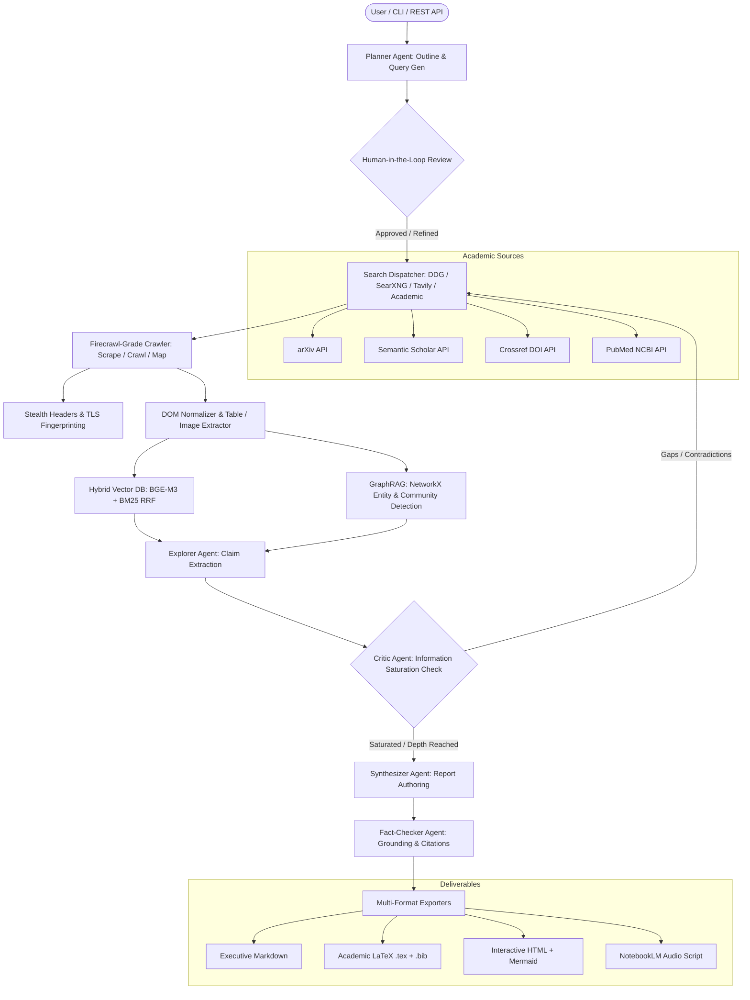

# OpenDeepResearcher 🔬🚀

[](https://github.com/Cyber-arghya/omni-researcher/actions/workflows/ci.yml)
[](https://www.python.org/downloads/)
[](https://opensource.org/licenses/MIT)
[](https://github.com/astral-sh/ruff)
[](https://mypy-lang.org/)

**OpenDeepResearcher** is a production-grade, open-source autonomous deep research system. It functions as an autonomous research team—formulating multi-perspective search queries, executing stealth browser crawls, parsing complex academic literature, detecting knowledge graph communities via **GraphRAG**, and synthesizing publication-ready research reports in Academic LaTeX, interactive HTML, and podcast-style audio scripts.

It operates **100% locally** (via Ollama or LM Studio) with a **$0.00 compute budget** or seamlessly connects to frontier cloud APIs (OpenAI, Gemini, Anthropic, DeepSeek, Groq).

---

## 🏛️ System Architecture



---

## ✨ Key Capabilities

### 1. 🧠 GraphRAG & Hybrid Vector RAG
- **Dense + Sparse Hybrid RAG**: BGE-M3 dense embeddings combined with BM25 keyword matching via Reciprocal Rank Fusion (RRF).
- **Knowledge Graph (NetworkX / Neo4j)**: Automatically extracts entities (Technologies, People, Metrics, Organizations) and predicates (`DEVELOPS`, `ACCELERATES`, `CONFLICTS_WITH`).
- **Community Detection**: Identifies cross-domain conceptual clusters using Clauset-Newman-Moore modularity.

### 2. 👁️ Multi-Modal Vision Analysis
- Automatically extracts figures, diagrams, and benchmarks from web articles and academic PDFs.
- Analyzes visual data using local vision models (`llama3.2-vision`) or cloud vision APIs (`gpt-4o`, `gemini-1.5-pro`).
- Includes VRAM-aware pre-flight checks to fallback gracefully to cloud or text-only if local VRAM is constrained.

### 3. 🕸️ Firecrawl-Grade Web Crawling
- **Endpoints**: Native implementation of `/scrape`, `/crawl`, and `/map`.
- **Anti-Bot Evasion**: Realistic TLS fingerprints, HTTP/2 header sequences, randomized browser signatures, and referer chains.
- **Paywall & DOM Cleaning**: Strips cookie banners, tracking scripts, and popups while preserving `<article>`, tables, and math equations.

### 4. 📊 Tabular Intelligence (Spreadsheets & CSVS)
- Parses multi-sheet Excel files (`.xlsx`, `.xls`) and CSVs via `openpyxl` and `pandas`.
- Supports column filtering and cell range extraction for structured statistical analysis.
- Rejects dangerous macro-enabled workbooks (`.xlsm`) automatically.

### 5. 📚 Broad Academic Integration
- **arXiv**: Fetches pre-prints across Computer Science, Physics, and Math with Atom XML parsing.
- **Semantic Scholar**: Integrates academic citation counts and paper influence graphs.
- **Crossref**: Resolves DOIs and verifies peer-reviewed publication metadata.
- **PubMed**: Queries biomedical and clinical studies via NCBI Entrez e-utilities.

### 6. 🤝 Active Human-in-the-Loop (HITL) Steering
- **Interactive Outline Approval**: The user inspects and steers the research plan before expensive crawling begins.
- **Mid-Execution Rabbit Hole Guards**: Triggers interactive user consultation if contradictory claims or ambiguity exceed thresholds.
- **Unattended Mode (`-u`)**: Available for overnight batch research jobs.

### 7. 🛡️ AST Pre-Flight Security Pipeline
- **Gate 1**: Validates AST against dangerous Python calls (`os.system`, `subprocess`, `eval`, `builtins.__import__`).
- **Gate 2**: Confines filesystem writes strictly inside `<workspace>/storage` and `<workspace>/reports`. Blocks Windows reserved device names (`CON`, `PRN`, `AUX`, `NUL`).
- **Gate 3**: Enforces SSRF defense (blocks private IP ranges `10.0.0.0/8`, `192.168.0.0/16`, `127.0.0.1`, `169.254.169.254`).
- **Gate 4**: Strips prompt injection traps from scraped HTML text.
- **Gate 5**: Strips malicious XSS `<script>` payloads from final report markdown.

### 8. 📄 Multi-Format Publication Exporters
- **Academic LaTeX**: Compiles `.tex` file with standard `article` class, abstract, and automatically formatted `.bib` BibTeX reference list.
- **Interactive HTML**: Standalone HTML document featuring typography, interactive table of contents, and responsive Mermaid.js diagrams.
- **Executive Markdown**: Clean GitHub-flavored markdown with numbered footnotes.
- **Audio Script**: NotebookLM-style dialogue between Host and Co-host summarizing key discoveries.

### 9. 🎛️ Autonomous Dynamic Hardware Profiler
- **Hardware Probing**: Automatically inspects host GPU VRAM and System RAM (via `torch.cuda` and `psutil`).
- **Dynamic 4-Tier Scaling**: Seamlessly routes between `entry_8gb` (8GB VRAM / 16GB RAM laptops), `enthusiast_16gb` (RTX 4070/4080), `workstation_24gb_plus` (RTX 4090 / 64GB RAM), and `cloud_hybrid`.
- **Zero OOM Invariant**: Prevents CUDA out-of-memory crashes on consumer laptops while unleashing 12-16 parallel crawlers and 32B models on high-end workstations.

### 10. 🌐 Interactive Web UI Cockpit (FastAPI + SSE)
- **Zero-Build Architecture**: Modern Single-Page Application (SPA) served directly from FastAPI static assets (`http://localhost:8000`) with zero `node_modules` required.
- **Live Agent Timeline**: Real-time progress cards powered by Server-Sent Events (SSE).
- **Interactive Graph Mesh**: Physics-based Vis-Network canvas visualizing GraphRAG entities, predicates, and communities.
- **Active HITL Banner**: Interactive one-click steering and outline approval directly in the browser.

---

## ⚡ Quickstart

### Installation (with `uv`)
```bash
# Clone repository
git clone https://github.com/Cyber-arghya/omni-researcher.git
cd omni-researcher

# Install dependencies using uv
uv sync
```

### Configuration
Copy `.env.example` to `.env` and configure your API keys (or leave blank to run 100% locally):
```bash
cp .env.example .env
```

### Run Autonomous Research via CLI
```bash
# 1. Run 100% locally with Ollama ($0 compute budget)
uv run opendeepresearcher "Commercial Viability of Solid-State Batteries in EVs by 2028" --local

# 2. Run with NVIDIA NIM (e.g. Nemotron-3 550B reasoning model)
uv run opendeepresearcher "Next-Generation Perovskite Solar Cell Degradation Mechanisms"

# 3. Run with deep recursion (Depth 3) and unattended mode
uv run opendeepresearcher "Mechanisms of Action of GLP-1 Receptor Agonists in Neurodegenerative Diseases" --depth 3 --unattended
```

### 🌐 Launch the Interactive Web UI Cockpit
OpenDeepResearcher provides a zero-build, single-page application (SPA) cockpit served directly through FastAPI:
```bash
# Launch Cockpit at http://localhost:8000 and auto-open default browser
uv run opendeepresearcher ui

# Run on custom host/port or remote headless server (no browser auto-open)
uv run opendeepresearcher ui --host 0.0.0.0 --port 8000 --no-browser
```
**Cockpit Capabilities:**
- **Dynamic Hardware Pill**: Displays detected VRAM, RAM, and hardware tier in the top navigation header.
- **Real-Time Execution Timeline**: Live agent status (Planning, Searching, Crawling, Indexing, Critiquing, Synthesizing) via Server-Sent Events (SSE).
- **Interactive GraphRAG Physics Canvas**: Explore extracted entity knowledge networks with Vis-Network.
- **Human-in-the-Loop Steering**: Approve, pivot, or abort ongoing missions in real time.
- **Instant Multi-Format Exporter**: One-click download for Markdown, Academic LaTeX, and in-browser NotebookLM-style Audio Podcast player.

---

## 🔑 Complete API Key Setup Guide

OpenDeepResearcher is engineered around a **zero-leakage, zero-cost-by-default architecture**. You can run the entire deep research pipeline without paying a single cent, or connect enterprise models like NVIDIA NIM and OpenAI.

> [!IMPORTANT]
> **Security Guarantee**: Never commit your real `.env` file to Git. OpenDeepResearcher automatically isolates `.env` in `.gitignore`. All keys are loaded at runtime through environment variables.

### 1. 100% Free Local Execution (Ollama / LM Studio)
Run state-of-the-art models completely offline on your own GPU/CPU with $0 API costs. OpenDeepResearcher dynamically tunes model weights, KV cache, and crawler concurrency based on your detected hardware:

#### 🎛️ Dynamic Hardware Tiers

| Hardware Profile | Physical Specs | Recommended Models (Fast / Deep) | Embeddings | Concurrency |
|---|---|---|---|---|
| **`entry_8gb`** | **<= 8GB VRAM / 16GB RAM** *(Laptops)* | `llama3.2:3b` / `qwen2.5:7b` (or `deepseek-r1:7b`) | CPU-Pinned (`nomic-embed-text`) | 3 crawlers |
| **`enthusiast_16gb`** | **12GB-16GB VRAM / 32GB RAM** *(RTX 4070/4080)* | `llama3.1:8b` / `qwen2.5:14b` (or `deepseek-r1:14b`) | GPU `bge-m3` (FP16) | 6 crawlers |
| **`workstation_24gb_plus`** | **24GB+ VRAM / 64GB+ RAM** *(RTX 4090 / Mac Studio)* | `qwen2.5:14b` / `qwen2.5:32b` (or `deepseek-r1:32b`) | High-Batch `bge-m3` | 12-16 crawlers |
| **`cloud_hybrid`** | **Any System** *(Even a $5 VPS)* | Offloaded to NVIDIA NIM (`nemotron-3-ultra-550b`) | CPU / Cloud | 6 crawlers |

#### Quick Ollama Pull Commands by Hardware:

```bash
# For 8GB VRAM / 16GB RAM (Safe, zero-OOM, ultra-fast):
ollama pull llama3.2:3b
ollama pull qwen2.5:7b
ollama pull nomic-embed-text

# For 16GB VRAM / 32GB RAM (High reasoning capacity):
ollama pull llama3.1:8b
ollama pull qwen2.5:14b
ollama pull llama3.2-vision:11b

# For 24GB+ VRAM Workstations (Maximum depth):
ollama pull qwen2.5:14b
ollama pull qwen2.5:32b
```

#### Configure `.env`:
```ini
LLM_PROVIDER=ollama
LLM_BASE_URL=http://localhost:11434/v1
HARDWARE_PROFILE=auto   # Automatically detects host VRAM & RAM
EMBEDDING_DEVICE=auto   # auto | cpu | cuda
```

Run with `--local`:
```bash
uv run opendeepresearcher "Quantum Computing Fault Tolerance Benchmarks" --local
```

### 2. NVIDIA NIM & Enterprise Reasoning Models (Nemotron)
NVIDIA provides 1,000 free API credits to developers on [build.nvidia.com](https://build.nvidia.com):
1. Sign in to NVIDIA build, select **Nvidia Nemotron** or **Llama-3.1-405B**, and generate your API key (`nvapi-...`).
2. Add to your local `.env`:
   ```ini
   LLM_PROVIDER=nvidia
   NVIDIA_API_KEY=nvapi-your-actual-key-here
   NVIDIA_BASE_URL=https://integrate.api.nvidia.com/v1
   NVIDIA_MODEL=nvidia/nemotron-3-ultra-550b-a55b
   ```
3. The client natively extracts `reasoning_content` (thinking tokens) and applies `enable_thinking: true` automatically.

### 3. Web Search & Academic Literature APIs
| Engine / API | Required Key? | Setup Instructions |
|---|---|---|
| **DuckDuckGo** | **No** (100% Free) | Default search engine. Works immediately out of the box with zero configuration. |
| **arXiv API** | **No** (100% Free) | Native Atom XML search for Physics, CS, and Math pre-prints. |
| **Crossref DOI** | **No** (100% Free) | Resolves and verifies peer-reviewed scientific literature across all journals. |
| **PubMed NCBI** | **No** (Optional) | Add `NCBI_PUBMED_API_KEY` in `.env` only if you need >3 requests/second rate limits. |
| **Semantic Scholar** | **No** (Optional) | Add `SEMANTIC_SCHOLAR_API_KEY` in `.env` for academic citation metrics. |
| **Tavily Search** | Optional (1,000 free) | Set `SEARCH_PROVIDER=tavily` and `TAVILY_API_KEY=tvly-...` in `.env`. |

### 4. Frontier Cloud APIs (Gemini, OpenAI, Claude, DeepSeek)
```ini
# OpenAI
LLM_PROVIDER=openai
OPENAI_API_KEY=sk-...

# Google Gemini
LLM_PROVIDER=gemini
GEMINI_API_KEY=AIzaSy...

# DeepSeek
LLM_PROVIDER=deepseek
DEEPSEEK_API_KEY=sk-...
```

---

## 🐳 Production Docker Deployment & Model Bridging

OpenDeepResearcher includes a security-hardened multi-stage Docker image operating as a non-privileged user (`researcher`).

### Scenario A: Running Docker with Cloud APIs or NVIDIA NIM
Pass your local `.env` securely at container startup without baking keys into image layers:

```bash
# 1. Build the production container image
docker build -t omni-researcher:latest .

# 2. Run research mission via Docker with .env credentials
docker run --rm -it \
  --env-file .env \
  -v "${PWD}/reports:/app/reports" \
  -v "${PWD}/storage:/app/storage" \
  omni-researcher:latest \
  opendeepresearcher "Solid-State Battery Energy Density Benchmarks 2026"
```

### Scenario B: Connecting Docker Container to Local Host Ollama
When running OpenDeepResearcher inside Docker while your Ollama runs on the host machine:

1. **Configure Host Ollama to accept Docker requests**:
   - **Linux**: Edit `/etc/systemd/system/ollama.service.d/override.conf` and set `Environment="OLLAMA_HOST=0.0.0.0"`, then `systemctl restart ollama`.
   - **Windows / macOS**: Ollama automatically listens for requests. Ensure firewall permits connection from Docker.
2. **Configure `.env` for Docker**:
   ```ini
   LLM_PROVIDER=ollama
   LLM_BASE_URL=http://host.docker.internal:11434/v1
   ```
3. **Run with Host Network Bridge**:
   ```bash
   docker run --rm -it \
     --add-host=host.docker.internal:host-gateway \
     --env-file .env \
     -v "${PWD}/reports:/app/reports" \
     omni-researcher:latest \
     opendeepresearcher "Advances in Solid Electrolytes" --local
   ```

### Scenario C: Using Docker Compose
Run the FastAPI server or batch research missions effortlessly:
```bash
# Start background server with compose
docker compose up -d

# Execute CLI research job inside compose environment
docker compose run --rm researcher opendeepresearcher "CRISPR Therapeutics in 2026"
```

---

## 💻 CLI Command Reference

`uv run opendeepresearcher [OPTIONS] TOPIC`

| Option | Flag | Type | Default | Description |
|---|---|---|---|---|
| `--depth` | `-d` | `int` | `2` | Search recursion depth (1-4). Controls multi-hop discovery. |
| `--local` | `-l` | `bool` | `False` | Run 100% locally with Ollama (Fast: `llama3.2:3b`, Deep: `qwen2.5:14b`). |
| `--unattended` | `-u` | `bool` | `False` | Run fully autonomously without interactive HITL pauses. |
| `--help` | | `bool` | | Show help menu and options. |

---

## 🌐 REST API Server

OpenDeepResearcher includes a FastAPI server supporting Firecrawl-compatible endpoints and background research missions:

```bash
uv run uvicorn src.server:app --host 0.0.0.0 --port 8000
```

### Endpoints
- `POST /research`: Trigger a background deep research job.
- `GET /reports/{session_id}`: Retrieve research results and generated file paths.
- `POST /scrape`: Firecrawl-compatible single URL stealth scraper.
- `POST /crawl`: Breadth-first website crawler with domain boundaries.
- `POST /map`: Rapid sitemap and link discovery endpoint.

---

## 🐳 Docker Deployment

The project provides a production-hardened multi-stage Dockerfile adhering to non-root execution (`researcher` user) and zero secret leakage.

```bash
# Build and start via Docker Compose
docker compose up -d --build

# View logs
docker compose logs -f
```

The container automatically connects to host-hosted Ollama instances via `host.docker.internal:11434`.

---

## 🧪 Testing & Verification

The codebase includes an automated test suite, Ruff linting, and Mypy static type checking:

```bash
# Run Ruff lint check
uv run ruff check src tests evals

# Run Ruff code formatter check
uv run ruff format --check src tests evals

# Run Mypy static type verification across 54 source files
uv run mypy src/

# Execute complete pytest suite
uv run pytest -v
```

---

## 📊 Evaluation & Hallucination Benchmarks

OpenDeepResearcher provides built-in benchmarking utilities under `evals/`:
- `evals/citation_accuracy.py`: Verifies that every factual claim in the synthesized report maps to a retrieved chunk ID.
- `evals/hallucination_eval.py`: Measures hallucination index and citation precision against source ground truth.
- `evals/run_benchmarks.py`: Batch evaluation harness across benchmark topics.

Run evaluations:
```bash
uv run python evals/run_benchmarks.py
```

---

## 📄 License
Released under the [MIT License](LICENSE).
