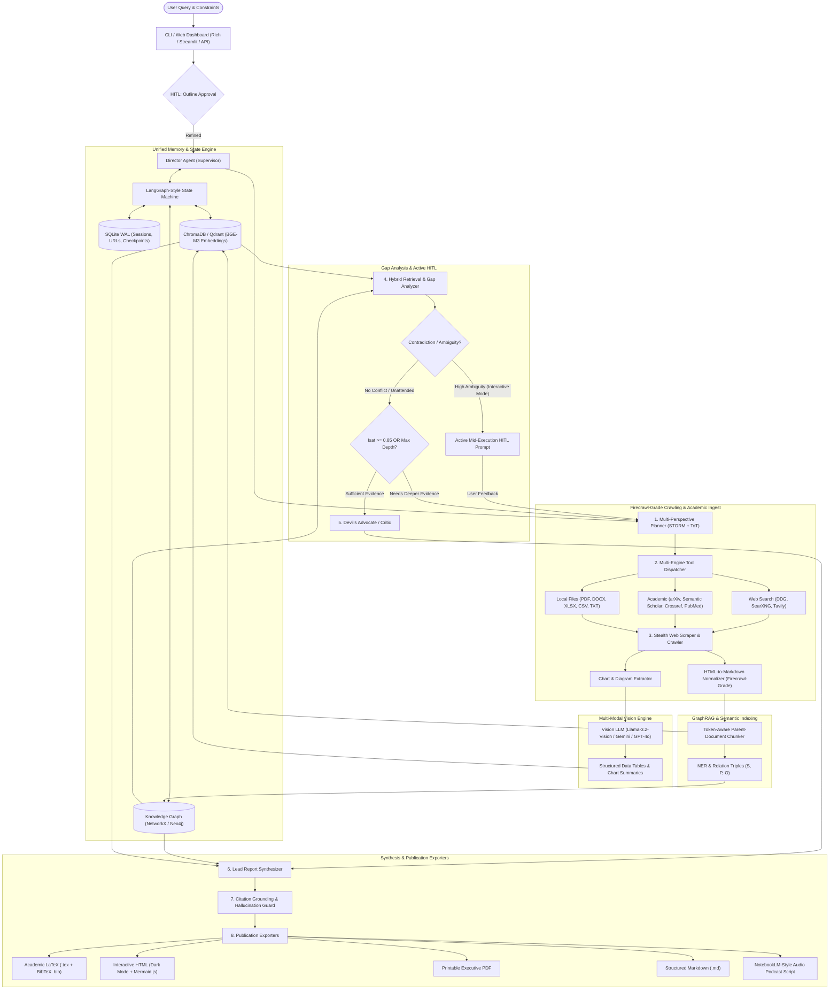

# Open-Source Autonomous Deep Research Agent (OpenDeepResearcher)
## Master Architectural Blueprint & Open-Source Specification

---

## 1. Executive Summary & Vision

**OpenDeepResearcher** is an open-source, production-grade autonomous deep research platform designed to be released as a flagship GitHub repository that matches and surpasses proprietary systems (OpenAI Deep Research, Google Gemini Deep Research, Perplexity Deep Research, and Stanford STORM).

### Core Differentiators:
1. **100% Model Agnostic**: Runs effortlessly on local LLMs (Ollama, LM Studio, vLLM) or frontier cloud APIs (Gemini 2.0, OpenAI o3-mini/gpt-4o, Claude 3.5 Sonnet, DeepSeek-R1).
2. **GraphRAG + Hybrid Vector Retrieval**: Combines dense/sparse vector search with knowledge graphs (NetworkX zero-infra default, pluggable Neo4j) to map complex relationships across hundreds of heterogeneous sources.
3. **Multi-Modal Vision Analysis**: Automatically extracts diagrams, charts, and plots from PDFs and websites; parses them using vision models (Llama-3.2-Vision, Gemini Flash, GPT-4o) into structured data tables and analytical insights.
4. **Firecrawl-Grade Web Crawling**: In-house stealth crawling engine with anti-bot evasion, JavaScript SPA rendering, DOM cleaning, and high-fidelity Markdown conversion.
5. **Universal Academic Retrieval**: Native integration with **arXiv**, **Semantic Scholar**, **Crossref**, and **PubMed**.
6. **Active Human-in-the-Loop (HITL)**: Interactive outline steering upfront, plus mid-execution pause triggers when contradictions, ambiguity, or rabbit holes are detected (with a `--unattended` flag for headless execution).
7. **Academic LaTeX & Multi-Format Exporters**: Outputs publication-grade LaTeX (`.tex` + BibTeX `.bib`), interactive standalone HTML with Mermaid diagrams, executive PDFs, and NotebookLM-style audio scripts.

---

## 2. The 10 Core Architectural Pillars

```
+---------------------------------------------------------------------------------------------------------+
|                                    THE 10 CORE ARCHITECTURAL PILLARS                                    |
+------------------------------------+--------------------------------------------------------------------+
| 1. Autonomous Planning & Reasoning | STORM multi-perspective planning, Tree-of-Thought (ToT),           |
|                                    | Information Saturation Index (Isat), Dynamic re-scoping.           |
+------------------------------------+--------------------------------------------------------------------+
| 2. GraphRAG & Knowledge Graphs     | Microsoft GraphRAG paradigm: Entity/Relation extraction (NER),     |
|                                    | NetworkX (local) + Neo4j (enterprise), Community detection (Leiden)|
+------------------------------------+--------------------------------------------------------------------+
| 3. Advanced Hybrid Vector RAG      | BAAI/bge-m3 (Dense + Sparse Lexical + Multi-Vector ColBERT),       |
|                                    | Parent-Document retrieval, Reciprocal Rank Fusion (RRF).           |
+------------------------------------+--------------------------------------------------------------------+
| 4. Multi-Modal Vision Processing   | Playwright/PDF image extraction, Visual Chart-to-Table analyzer,   |
|                                    | Llama-3.2-Vision / Gemini / GPT-4o diagram comprehension.          |
+------------------------------------+--------------------------------------------------------------------+
| 5. Firecrawl-Grade Web Extraction  | Stealth Playwright crawling, Anti-bot TLS fingerprinting bypass,   |
|                                    | Deep-crawl (/crawl, /scrape, /map), HTML-to-clean-Markdown parser.  |
+------------------------------------+--------------------------------------------------------------------+
| 6. Broad Academic & Open Science   | Native arXiv, Semantic Scholar, Crossref, and PubMed API adapters. |
+------------------------------------+--------------------------------------------------------------------+
| 7. Multi-Agent Framework           | LangGraph-style cyclic StateGraph + CrewAI-style role delegation   |
|                                    | (Director, Planner, Explorer, Graph Builder, Critic, Synthesizer). |
+------------------------------------+--------------------------------------------------------------------+
| 8. Active Human-in-the-Loop (HITL) | Upfront outline review + Mid-execution ambiguity/conflict alerts,  |
|                                    | Resumable directional steering, or headless autonomous mode.       |
+------------------------------------+--------------------------------------------------------------------+
| 9. Unified 3-Tier Memory Engine    | Working Memory (scratchpad), Episodic Memory (SQLite WAL session), |
|                                    | Semantic Memory (ChromaDB + NetworkX), Resumable checkpoints.      |
+------------------------------------+--------------------------------------------------------------------+
| 10. Multi-Format Exporters         | Publication-ready LaTeX (.tex + .bib), Standalone HTML (Mermaid),  |
|                                    | Executive PDF, Markdown, and NotebookLM-style Audio Script.        |
+------------------------------------+--------------------------------------------------------------------+
```

---

## 3. End-to-End Execution Workflow Diagram



---

## 4. In-Depth Technical Logic & Algorithms

### 4.1 GraphRAG: Knowledge Graph Synergy
*   **The Problem with Vector-Only RAG**: Vector similarity search finds semantically close paragraphs, but fails at multi-hop global questions like *"How do the geopolitical decisions of Nation A connect through trade agreements to the silicon shortages affecting Company B?"*
*   **GraphRAG Architecture**:
    1. **Entity & Relation Extraction**: After scraping text chunks, an extraction prompt identifies entities `(Subject, Type)` and relations `(Subject, Predicate, Object, Confidence)`.
    2. **Graph Construction**: Entities become nodes; relations become directed, weighted edges in a `networkx.DiGraph` (zero-infra default) or Neo4j.
    3. **Disk & SQLite Persistence**: To prevent knowledge loss across sessions or reboots, the in-memory NetworkX graph is atomically persisted to `storage/knowledge_graph.json` and synchronized with an SQLite relational graph table (`graph_edges`).
    4. **Community Detection (Leiden Algorithm)**: Groups closely related entities into hierarchical clusters.
    5. **Global Community Summarization**: Generates executive summaries for each community cluster, enabling the agent to answer high-level holistic queries.
    6. **Graph Traversal Retrieval**: When synthesizing reports, the agent executes multi-hop graph walks to discover non-obvious correlations between disparate web sources.

### 4.2 Multi-Modal Vision Processing
*   **Pipeline & Graceful Degradation**:
    1. During PDF parsing (`pdfplumber` / `pypdf`) or web page rendering (Playwright), images matching chart/figure heuristics (aspect ratio, presence of captions like "Figure 1", "Chart", "Table") are extracted.
    2. **VRAM & Hardware Safety Check (Graceful Fallback)**:
       - If a local Vision model (`llama3.2-vision:11b`) is requested but the host lacks sufficient VRAM (or runs on CPU/integrated graphics), the system **never crashes**.
       - Instead, it logs an informative warning and automatically degrades gracefully: falls back to optical OCR (`pytesseract`), nearby HTML/PDF caption text extraction, or a cloud vision API if configured.
    3. When available, the Vision model returns:
       - Structured Markdown representation of the underlying data points.
       - Key takeaway summary of trends, anomalies, and conclusions.
    4. This extracted text is indexed into ChromaDB and linked back to the original image file, allowing the final report to embed both the image and the verified data table.

### 4.3 Firecrawl-Grade Web Crawling & Normalization
*   **Capabilities**:
    - `/scrape`: Clean, single-page extraction with cookie-banner stripping and main content isolation.
    - `/crawl`: Recursive domain crawling with depth limits, URL pattern whitelisting/blacklisting, and sitemap exploration.
    - `/map`: Rapid URL discovery across a target domain without downloading full HTML.
*   **Anti-Bot & Stealth Engine**:
    - Uses `playwright-stealth` techniques: randomized navigator properties, authentic viewport sizes, spoofed HTTP/2 headers, and mouse jitter.
    - Automatic fallback hierarchy:
      $$\text{Async HTTP (Trafilatura)} \xrightarrow[\text{blocked / empty}]{} \text{Stealth Headless Chromium} \xrightarrow[\text{blocked}]{} \text{Google Web Cache / Archive.org}$$
*   **DOM Normalization**: Raw HTML is stripped of scripts, SVGs, styles, tracking pixels, and navbars, converting messy DOM trees into pristine, semantic Markdown with clean tables.

### 4.4 Broad Academic & Open Science APIs
*   **arXiv API**: Core pre-prints in Physics, Mathematics, Computer Science, and Quantitative Biology.
*   **Semantic Scholar API**: Academic citation graphs, highly cited papers, TLDR summaries, and author influence scores.
*   **Crossref API**: DOI resolution, metadata verification, peer-reviewed journals across humanities, social sciences, and engineering.
*   **PubMed API**: Biomedical literature, clinical trials, and life sciences via NCBI Entrez e-utilities.

### 4.5 Active Human-in-the-Loop (HITL) Mid-Execution
*   **Pre-Execution Phase**: User approves or edits the initial multi-perspective research outline.
*   **Mid-Execution Trigger Conditions**:
    - **Contradiction Threshold**: When two highly ranked sources present conflicting factual claims (e.g., conflicting market share statistics or opposing trial results), the agent pauses and asks: *"Found opposing findings: Source A claims X (+15%), Source B claims Y (-5%). How should this controversy be weighted?"*
    - **Rabbit-Hole / Low-Relevance Alert**: When sub-queries return low cosine similarity (< 0.40) to the core mission, the agent asks for confirmation before continuing.
    - **Interactive CLI & Web Controls**: Supports CLI input or API webhooks.
    - **`--unattended` Flag**: Fully autonomous mode where conflicts are logged objectively under a dedicated *"Controversies & Opposing Viewpoints"* section without pausing.

### 4.6 Embedding Model Upgrade
*   **Default Local Embedding**: `BAAI/bge-m3`
    - Multi-lingual (100+ languages).
    - 8,192 token input context window (can embed entire technical sections without awkward fragmentation).
    - Tri-mode representations: Dense vectors, Sparse lexical weights (learned BM25), and Multi-vector ColBERT-style interactions.
*   **Cloud Fallback**: OpenAI `text-embedding-3-large` or Google `text-embedding-004`.

### 4.7 Structured Data & Spreadsheet Intelligence (`openpyxl` + `pandas`)

Research often requires extracting, analyzing, and cross-referencing **tabular data** locked inside Excel spreadsheets (`.xlsx`, `.xls`), CSVs, and Google Sheets exports. The agent natively parses these using `openpyxl` and `pandas`.

*   **Capabilities**:
    1. **Multi-Sheet XLSX Parsing**: Opens workbooks with multiple sheets; user can target a specific sheet by name or index, or the agent auto-discovers all sheets and extracts data from each.
    2. **Column/Row-Level Precision Extraction**: Query specific columns (by header name or letter, e.g., `"Revenue"` or `"C"`) and row ranges (e.g., rows 10-50) rather than blindly ingesting the entire file.
    3. **Auto-Schema Detection**: Uses `pandas.read_excel()` with `header` auto-detection to infer column names, data types (`int`, `float`, `datetime`, `str`), and missing value patterns.
    4. **Pivot, Filter & Aggregate**: Agent can programmatically apply `pandas` operations (groupby, pivot_table, describe, value_counts) to answer analytical questions about the data.
    5. **Chart-to-Data Recovery**: When an XLSX contains embedded Excel charts, `openpyxl` extracts the chart's underlying data series (source ranges) and converts them into structured `pandas.DataFrame` tables.

*   **Pipeline**:
    ```
    User uploads .xlsx/.csv
          │
          ▼
    openpyxl.load_workbook() ──► List all sheet names
          │
          ▼
    pandas.read_excel(sheet_name=...) ──► DataFrame per sheet
          │
          ├──► Schema inference (dtypes, null %, unique counts)
          ├──► Targeted column/row extraction (user-specified or auto)
          ├──► Statistical summary (describe, correlations)
          └──► Markdown table conversion for LLM context injection
                │
                ▼
          Chunk as structured text ──► Embed into ChromaDB (Vector RAG)
                                  ──► Extract entities ──► Knowledge Graph (GraphRAG)
    ```

*   **Libraries**:
    | Library | Version | Purpose |
    | :--- | :--- | :--- |
    | `openpyxl` | ≥ 3.1 | Read/write `.xlsx` workbooks, access individual cells, sheets, and embedded charts |
    | `pandas` | ≥ 2.2 | High-performance DataFrame operations, Excel/CSV I/O, pivot tables, statistical analysis |
    | `python-calamine` | ≥ 0.3 | Ultra-fast Rust-based Excel reader for large files (optional `pandas` engine: `engine="calamine"`) |

*   **Integration with RAG & GraphRAG**:
    - Extracted DataFrames are serialized to Markdown tables and chunked for vector embedding (ChromaDB).
    - Column headers and categorical values become entities in the Knowledge Graph; numeric relationships (e.g., "Company X → Revenue → $4.2B") become weighted edges.
    - The Hybrid Retriever (Dense + BM25 RRF) can then answer queries like *"Which company had the highest revenue growth in Q3?"* by combining semantic search over narrative text with precise tabular lookups.

*   **Security Guard**:
    - File size limit enforced (default: 50 MB max per upload).
    - Macro-enabled files (`.xlsm`) are rejected by default (`keep_vba=False`) to prevent macro injection.
    - `openpyxl` runs in read-only mode (`read_only=True`) for large files to prevent memory exhaustion.

### 4.8 Pure Python Agent StateGraph vs. Framework Bloat (First-Principles Architectural Decision)
*   **The Trap of Monolithic Agent Frameworks**:
    - Combining LangChain, LangGraph, CrewAI, AutoGen, and LlamaIndex simultaneously creates severe dependency conflicts (e.g. incompatible Pydantic v1/v2 requirements, diverging asyncio event loop designs, breaking sub-package updates, and massive 1.5GB+ container bloat).
*   **The Clean Engineering Solution**:
    - Instead of importing bloated 3rd-party agent frameworks, **OpenDeepResearcher** adopts their *architectural strengths* natively using pure Python `asyncio` and `pydantic`:
      - **LangGraph pattern**: Deterministic cyclic StateGraph with explicit state nodes, conditional edges, and checkpointed state transitions.
      - **CrewAI pattern**: Role-specialized agents with distinct system prompts and clear input/output contracts.
      - **LlamaIndex pattern**: Parent-Document chunking and hybrid dense/sparse retrieval.
    - **Result**: Zero dependency hell, instant startup (< 50ms), minimal container footprint, and 100% transparent debugging.

### 4.9 Cost & Token Budget Guardrails (Financial & Resource Safety)
*   When executing autonomous deep research loops with frontier cloud APIs (OpenAI, Gemini, Claude), unbounded recursive agent searches can incur unexpected financial costs.
*   The system enforces hard, non-bypassable guardrails in `src/config.py`:
    1. **`MAX_COST_LIMIT_USD: float = 2.0`**: Real-time cost accumulator calculated from model token usage. If the estimated cost exceeds this threshold, the research loop halts and prompts the user or finalizes the report with available evidence.
    2. **`MAX_TOTAL_TOKENS: int = 150_000`**: Hard cap on combined prompt + completion tokens per research session across all agents.
    3. **Live Cost Telemetry**: Terminal CLI displays running token counts and estimated USD cost in real-time.

---

## 5. Modern Toolchain, Security Pre-Flight & Cross-Platform CI/CD

### 5.1 Modern Toolchain: `uv` + `ruff` + `mypy`

Traditional `pip` + `flake8` + `black` toolchains are fragmented, slow, and version-conflict-prone. This project enforces a **next-generation Python development stack**:

| Tool | Replaces | Purpose & Justification |
| :--- | :--- | :--- |
| **`uv`** (Astral) | `pip`, `pip-tools`, `virtualenv`, `poetry` | 10-100x faster dependency resolution & virtual environment creation. Written in Rust. Single binary, zero bootstrap overhead. Generates deterministic `uv.lock` lockfile for reproducible builds across all OS. |
| **`ruff`** (Astral) | `flake8`, `black`, `isort`, `pyflakes`, `bandit` | Single unified linter + formatter. 50-100x faster than flake8. Covers 800+ lint rules, import sorting, security patterns (`S` rules for Bandit equivalent), and auto-fix. |
| **`mypy`** (strict mode) | Manual type checking | Static type analysis with `--strict` flag. All public function signatures require explicit type annotations. Catches `None` dereferencing, missing return types, and type mismatches at CI time, not runtime. |

**`pyproject.toml` Toolchain Configuration**:
```toml
[project]
name = "opendeepresearcher"
version = "0.1.0"
requires-python = ">=3.11"

[tool.uv]
dev-dependencies = [
    "pytest>=8.0",
    "pytest-asyncio>=0.24",
    "pytest-cov>=6.0",
    "mypy>=1.13",
    "ruff>=0.8",
]

[tool.ruff]
target-version = "py311"
line-length = 100
src = ["src"]

[tool.ruff.lint]
select = [
    "E", "W",       # pycodestyle errors & warnings
    "F",             # pyflakes
    "I",             # isort (import ordering)
    "N",             # pep8-naming conventions
    "UP",            # pyupgrade (modernize syntax)
    "S",             # flake8-bandit (security patterns)
    "B",             # flake8-bugbear (common bugs)
    "A",             # flake8-builtins (shadowing prevention)
    "C4",            # flake8-comprehensions
    "SIM",           # flake8-simplify
    "TCH",           # flake8-type-checking (TYPE_CHECKING blocks)
    "RUF",           # ruff-specific rules
]
ignore = ["S101"]    # Allow assert in tests

[tool.ruff.lint.isort]
known-first-party = ["src"]

[tool.mypy]
python_version = "3.11"
strict = true
warn_return_any = true
warn_unused_configs = true
disallow_untyped_defs = true
disallow_any_generics = true
no_implicit_optional = true
check_untyped_defs = true
```

### 5.2 AST Pre-Flight Verification (Tool Security)

When the agent dynamically generates or selects tool calls (search queries, scraper URLs, function arguments), there is a risk of **prompt injection, path traversal, or code injection**. The system enforces a strict pre-flight security pipeline:

```
+-----------------------------------------------------------------------------------------------------------+
|                              AST PRE-FLIGHT VERIFICATION PIPELINE                                         |
+-----------------------------+-----------------------------------------------------------------------------+
| Gate 1: Pydantic Schema     | Every tool argument is validated through a strict Pydantic model with        |
|         Enforcement         | `Annotated[str, Field(pattern=r"...")]` regex constraints.                  |
|                             | No raw string arguments are ever passed directly to shell or OS calls.      |
+-----------------------------+-----------------------------------------------------------------------------+
| Gate 2: AST Static Analysis | For any dynamically composed Python code (e.g., data transformation         |
|         (ast.parse)         | scripts), the system runs `ast.parse()` to verify syntactic validity        |
|                             | BEFORE execution. Disallowed AST nodes: `Import`, `ImportFrom`, `Exec`,    |
|                             | `Eval`, `Call` to `subprocess`, `os.system`, `shutil.rmtree`.              |
+-----------------------------+-----------------------------------------------------------------------------+
| Gate 3: Path Traversal      | All file paths are canonicalized via `pathlib.Path.resolve()` and           |
|         Guard               | verified to reside within the project's designated `storage/` or            |
|                             | `reports/` directories. Rejects any path containing `..`, absolute          |
|                             | paths outside the sandbox, or OS-specific edge cases (Windows `\\?\`        |
|                             | prefix, NUL device, reserved filenames like CON, PRN, AUX).                |
+-----------------------------+-----------------------------------------------------------------------------+
| Gate 4: URL & Domain        | Scraped URLs are validated against an allowlist of trusted TLDs and          |
|         Allowlist           | blocked patterns (e.g., `file://`, `localhost`, `169.254.*` link-local,     |
|                             | private IP ranges). Prevents SSRF (Server-Side Request Forgery).            |
+-----------------------------+-----------------------------------------------------------------------------+
| Gate 5: Output Sanitization | LLM-generated Markdown output is sanitized to strip `<script>`, `<iframe>`, |
|                             | `javascript:` URIs, and `data:` URIs before writing to HTML exports.        |
+-----------------------------+-----------------------------------------------------------------------------+
```

**Implementation in code** (`src/security/`):
```python
# src/security/preflight.py
import ast
from pathlib import Path
from pydantic import BaseModel, Field
from typing import Annotated

BLOCKED_AST_NODES = {ast.Import, ast.ImportFrom}
BLOCKED_CALL_NAMES = {"exec", "eval", "compile", "os.system", "subprocess.run", "subprocess.call"}

SANDBOX_ROOTS: list[Path] = []  # Set at startup from config

class ToolCallSchema(BaseModel):
    """Strict schema for every tool invocation argument."""
    query: Annotated[str, Field(max_length=500, pattern=r'^[^;<>&|`$]+$')]
    url: Annotated[str, Field(pattern=r'^https?://[^\s]+$')] | None = None
    file_path: Annotated[str, Field(max_length=260)] | None = None

def verify_ast_safety(code_str: str) -> bool:
    """Parse and walk AST to reject dangerous nodes."""
    tree = ast.parse(code_str, mode="exec")
    for node in ast.walk(tree):
        if type(node) in BLOCKED_AST_NODES:
            return False
    return True

def verify_path_sandbox(file_path: str) -> Path:
    """Resolve and confine path within sandbox boundaries."""
    resolved = Path(file_path).resolve()
    if not any(resolved.is_relative_to(root) for root in SANDBOX_ROOTS):
        raise PermissionError(f"Path escapes sandbox: {resolved}")
    # Windows reserved name check
    RESERVED = {"CON", "PRN", "AUX", "NUL"} | {f"COM{i}" for i in range(10)} | {f"LPT{i}" for i in range(10)}
    if resolved.stem.upper() in RESERVED:
        raise PermissionError(f"Reserved Windows filename: {resolved.name}")
    return resolved
```

### 5.3 Robust Cross-Platform CI/CD (GitHub Actions)

The project ships with a comprehensive `.github/workflows/ci.yml` that runs on **every push and pull request**, testing across **Windows, Linux, and macOS** with the modern `uv` toolchain:

```yaml
# .github/workflows/ci.yml
name: CI Pipeline

on:
  push:
    branches: [main, develop]
  pull_request:
    branches: [main]

permissions:
  contents: read

env:
  UV_CACHE_DIR: .uv-cache
  PYTHONDONTWRITEBYTECODE: "1"

jobs:
  lint-and-typecheck:
    name: Lint & Type Check
    runs-on: ubuntu-latest
    steps:
      - uses: actions/checkout@v4
      - uses: astral-sh/setup-uv@v4
        with:
          version: "latest"

      - name: Install dependencies
        run: uv sync --all-extras --dev

      - name: Ruff lint (800+ rules)
        run: uv run ruff check src/ tests/ --output-format=github

      - name: Ruff format check
        run: uv run ruff format --check src/ tests/

      - name: Mypy strict type analysis
        run: uv run mypy src/ --strict --no-error-summary

  test:
    name: Test (${{ matrix.os }} / Python ${{ matrix.python-version }})
    needs: lint-and-typecheck
    runs-on: ${{ matrix.os }}
    strategy:
      fail-fast: false
      matrix:
        os: [ubuntu-latest, windows-latest, macos-latest]
        python-version: ["3.11", "3.12", "3.13"]
    steps:
      - uses: actions/checkout@v4
      - uses: astral-sh/setup-uv@v4
        with:
          version: "latest"

      - name: Set up Python ${{ matrix.python-version }}
        run: uv python install ${{ matrix.python-version }}

      - name: Install dependencies
        run: uv sync --all-extras --dev

      - name: Run tests with coverage
        run: uv run pytest tests/ -v --tb=short --cov=src --cov-report=xml

      - name: Upload coverage
        if: matrix.os == 'ubuntu-latest' && matrix.python-version == '3.12'
        uses: codecov/codecov-action@v4
        with:
          files: coverage.xml

  cross-platform-paths:
    name: Path Normalization & Symlink Validation
    needs: lint-and-typecheck
    runs-on: ${{ matrix.os }}
    strategy:
      fail-fast: false
      matrix:
        os: [ubuntu-latest, windows-latest, macos-latest]
    steps:
      - uses: actions/checkout@v4
      - uses: astral-sh/setup-uv@v4
        with:
          version: "latest"

      - name: Install dependencies
        run: uv sync --all-extras --dev

      - name: Test path normalization (OS-specific edge cases)
        run: uv run pytest tests/test_path_normalization.py -v --tb=long

      - name: Test symlink resolution
        run: uv run pytest tests/test_symlinks.py -v --tb=long
        # Windows symlinks require Developer Mode or elevated privileges
        # This job verifies graceful degradation on restricted Windows runners

  security-audit:
    name: Security Audit
    runs-on: ubuntu-latest
    steps:
      - uses: actions/checkout@v4
      - uses: astral-sh/setup-uv@v4
        with:
          version: "latest"

      - name: Install dependencies
        run: uv sync --all-extras --dev

      - name: Ruff security rules (Bandit equivalent)
        run: uv run ruff check src/ --select S --output-format=github

      - name: AST pre-flight safety tests
        run: uv run pytest tests/test_ast_preflight.py -v

      - name: Dependency vulnerability scan
        run: uv pip audit

  docker-build:
    name: Docker Multi-Stage Build Verification
    needs: [test, security-audit]
    runs-on: ubuntu-latest
    steps:
      - uses: actions/checkout@v4

      - name: Build production image
        run: docker build --target runtime -t opendeepresearcher:ci .

      - name: Verify non-root execution
        run: |
          docker run --rm opendeepresearcher:ci whoami | grep -q researcher

      - name: Verify no build tools in runtime
        run: |
          docker run --rm opendeepresearcher:ci which gcc || true
          docker run --rm opendeepresearcher:ci pip list 2>/dev/null | grep -qv setuptools
```

**What This CI/CD Pipeline Guarantees**:

| CI Job | What It Catches | Coverage |
| :--- | :--- | :--- |
| **`lint-and-typecheck`** | Style violations, unused imports, type errors, missing annotations | `ruff` (800+ rules) + `mypy --strict` |
| **`test` (3×3 matrix)** | Functional regressions across 3 OSes × 3 Python versions | 9 parallel test runners, `pytest-cov` |
| **`cross-platform-paths`** | `\` vs `/` path bugs, `pathlib` edge cases, Windows reserved names (`CON`, `NUL`), symlink resolution differences | Dedicated path normalization test suite |
| **`security-audit`** | Hardcoded secrets, `subprocess` injection, SSRF URLs, dangerous `eval/exec`, dependency CVEs | Ruff `S` rules + AST pre-flight tests + `uv pip audit` |
| **`docker-build`** | Build tools leaking into production image, root user execution, missing runtime deps | Multi-stage build + `whoami` assertion |

### 5.4 Cross-Platform Path Normalization Test Suite

```python
# tests/test_path_normalization.py
"""Cross-platform path normalization and sandbox boundary tests.

Runs on Windows, Linux, and macOS via GitHub Actions matrix.
Verifies that all file I/O operations use pathlib correctly
and that path traversal attacks are blocked on every OS.
"""
import platform
import pytest
from pathlib import Path, PurePosixPath, PureWindowsPath
from src.security.preflight import verify_path_sandbox, SANDBOX_ROOTS

@pytest.fixture(autouse=True)
def _set_sandbox(tmp_path: Path) -> None:
    SANDBOX_ROOTS.clear()
    SANDBOX_ROOTS.append(tmp_path)

class TestPathNormalization:
    def test_forward_slash_normalized(self, tmp_path: Path) -> None:
        """Verify forward slashes work on all platforms."""
        p = tmp_path / "reports" / "test.md"
        p.parent.mkdir(parents=True, exist_ok=True)
        p.touch()
        result = verify_path_sandbox(str(p).replace("\\", "/"))
        assert result.exists()

    def test_backslash_on_windows(self, tmp_path: Path) -> None:
        """Verify backslash paths resolve correctly on Windows."""
        p = tmp_path / "storage" / "cache.db"
        p.parent.mkdir(parents=True, exist_ok=True)
        p.touch()
        result = verify_path_sandbox(str(p))
        assert result.exists()

    def test_traversal_attack_blocked(self, tmp_path: Path) -> None:
        """Path traversal with .. must be rejected."""
        malicious = str(tmp_path / "reports" / ".." / ".." / "etc" / "passwd")
        with pytest.raises(PermissionError, match="escapes sandbox"):
            verify_path_sandbox(malicious)

    @pytest.mark.skipif(platform.system() != "Windows", reason="Windows-only")
    def test_windows_reserved_names_blocked(self, tmp_path: Path) -> None:
        """Windows reserved filenames (CON, NUL, PRN, COM1) must be rejected."""
        for name in ["CON", "NUL", "PRN", "AUX", "COM1", "LPT1"]:
            with pytest.raises(PermissionError, match="Reserved"):
                verify_path_sandbox(str(tmp_path / f"{name}.txt"))

    @pytest.mark.skipif(platform.system() != "Windows", reason="Windows-only")
    def test_windows_unc_path_blocked(self, tmp_path: Path) -> None:
        """UNC paths (\\\\server\\share) outside sandbox must be rejected."""
        with pytest.raises(PermissionError):
            verify_path_sandbox("\\\\remote-server\\share\\secret.txt")

    def test_case_sensitivity(self, tmp_path: Path) -> None:
        """Verify case handling matches the OS filesystem behavior."""
        p = tmp_path / "Reports" / "Test.MD"
        p.parent.mkdir(parents=True, exist_ok=True)
        p.touch()
        result = verify_path_sandbox(str(p))
        assert result.resolve() == p.resolve()


# tests/test_symlinks.py
"""Symlink resolution tests across platforms.

On Windows, symlink creation requires Developer Mode or SeCreateSymbolicLinkPrivilege.
Tests gracefully skip if symlink creation fails (restricted CI runners).
"""
import os
import pytest
from pathlib import Path
from src.security.preflight import verify_path_sandbox, SANDBOX_ROOTS

@pytest.fixture(autouse=True)
def _set_sandbox(tmp_path: Path) -> None:
    SANDBOX_ROOTS.clear()
    SANDBOX_ROOTS.append(tmp_path)

def _can_create_symlink(tmp_path: Path) -> bool:
    try:
        target = tmp_path / "symlink_test_target.txt"
        target.touch()
        link = tmp_path / "symlink_test_link.txt"
        link.symlink_to(target)
        link.unlink()
        target.unlink()
        return True
    except (OSError, NotImplementedError):
        return False

class TestSymlinkResolution:
    def test_symlink_within_sandbox_allowed(self, tmp_path: Path) -> None:
        if not _can_create_symlink(tmp_path):
            pytest.skip("Symlinks not supported on this OS/runner")
        target = tmp_path / "storage" / "real_file.db"
        target.parent.mkdir(parents=True, exist_ok=True)
        target.touch()
        link = tmp_path / "storage" / "link_to_file.db"
        link.symlink_to(target)
        result = verify_path_sandbox(str(link))
        assert result == target.resolve()

    def test_symlink_escaping_sandbox_blocked(self, tmp_path: Path) -> None:
        if not _can_create_symlink(tmp_path):
            pytest.skip("Symlinks not supported on this OS/runner")
        # Create a symlink inside sandbox pointing outside
        outside_target = tmp_path.parent / "outside_secret.txt"
        outside_target.touch()
        malicious_link = tmp_path / "storage" / "escape_link.txt"
        malicious_link.parent.mkdir(parents=True, exist_ok=True)
        malicious_link.symlink_to(outside_target)
        with pytest.raises(PermissionError, match="escapes sandbox"):
            verify_path_sandbox(str(malicious_link))
        # Cleanup
        malicious_link.unlink()
        outside_target.unlink()
```

---

## 6. Complete Folder & File Architecture

```
OpenDeepResearcher/
├── .github/
│   ├── workflows/
│   │   ├── ci.yml                     # Cross-platform CI (uv + ruff + mypy + pytest, 3 OS × 3 Py)
│   │   ├── release.yml                # Automated PyPI packaging & Docker Hub push
│   │   └── security.yml               # Ruff S-rules + AST pre-flight + uv pip audit
│   └── ISSUE_TEMPLATE/
│       ├── bug_report.md
│       └── feature_request.md
│
├── .env.example                       # Ready-made configuration templates
├── .gitignore                         # Strict exclusion for secrets, cache, and DBs
├── LICENSE                            # Apache 2.0 or MIT Open-Source License
├── Dockerfile                         # Production multi-stage build (non-root 'researcher')
├── docker-compose.yml                 # Multi-container setup (Agent, SearXNG, Neo4j optional)
├── pyproject.toml                     # uv-managed metadata, ruff/mypy config, CLI entrypoints
├── uv.lock                            # Deterministic cross-platform lockfile (auto-generated by uv)
├── plan.md                            # This Master Architectural Blueprint
├── README.md                          # Viral GitHub README with architecture diagrams & benchmarks
│
├── src/
│   ├── __init__.py
│   ├── config.py                      # Pydantic Settings: LLM, Vision, Scraping, Vector & Graph
│   ├── cli.py                         # Rich interactive terminal interface with spinners & HITL
│   ├── server.py                      # FastAPI server for headless/web dashboard integration
│   │
│   ├── state/
│   │   ├── __init__.py
│   │   ├── schemas.py                 # Core Pydantic models (ResearchState, Document, Claim, Graph)
│   │   └── graph_machine.py           # LangGraph-style deterministic cyclic state engine
│   │
│   ├── llm/
│   │   ├── __init__.py
│   │   ├── client.py                  # Universal LLM wrapper (Local Ollama, Gemini, OpenAI, Claude)
│   │   ├── vision_client.py           # Multi-modal Vision API wrapper (Llama-Vision, GPT-4o, Gemini)
│   │   ├── router.py                  # Dual-tier router (Fast/Local Tier 1 vs Reasoning Tier 2)
│   │   └── prompts.py                 # System prompts for Planner, Critic, Graph Builder, Synthesizer
│   │
│   ├── search/                        # Multi-Engine Web Search Dispatcher
│   │   ├── __init__.py
│   │   ├── engine.py                  # Unified search client & rate-limiting queue
│   │   ├── ddg.py                     # DuckDuckGo free search backend (zero API key)
│   │   ├── searxng.py                 # Self-hosted SearXNG private search backend
│   │   └── tavily.py                  # Tavily API premium search backend
│   │
│   ├── crawler/                       # Firecrawl-Grade Web Crawling Engine
│   │   ├── __init__.py
│   │   ├── scraper.py                 # Tiered scraper: Trafilatura HTTP -> Stealth Playwright
│   │   ├── stealth.py                 # Anti-bot bypass (TLS fingerprints, viewport emulation)
│   │   ├── normalizer.py              # HTML-to-clean-Markdown converter with table recovery
│   │   ├── crawler_engine.py          # /scrape, /crawl, and /map recursive domain traverser
│   │   ├── image_extractor.py         # Visual chart and diagram extractor for vision pipeline
│   │   └── spreadsheet_parser.py      # XLSX/CSV parser (openpyxl + pandas, multi-sheet, col/row extraction)
│   │
│   ├── rag/
│   │   ├── __init__.py
│   │   ├── embeddings.py              # BAAI/bge-m3 local embedding engine + Cloud adapters
│   │   ├── text_splitter.py           # Token-aware Parent-Document chunker (300/1000 tokens)
│   │   ├── vector_store.py            # ChromaDB / Qdrant embedded vector database client
│   │   └── hybrid_retriever.py        # Dense + Sparse BM25 Reciprocal Rank Fusion (RRF)
│   │
│   ├── graph/                         # GraphRAG Knowledge Graph Engine
│   │   ├── __init__.py
│   │   ├── extractor.py               # Named Entity Recognition (NER) & Relation Triple extractor
│   │   ├── graph_store.py             # NetworkX (in-memory/file) & Neo4j graph database adapter
│   │   ├── community.py               # Leiden community detection & hierarchical clustering
│   │   └── graph_traversal.py         # Multi-hop graph walk & global community summarizer
│   │
│   ├── academic/                      # Broad Academic & Open Science Integrations
│   │   ├── __init__.py
│   │   ├── arxiv_client.py            # arXiv pre-print search & PDF downloader
│   │   ├── semantic_scholar.py        # Semantic Scholar citation graph & TLDR API
│   │   ├── crossref_client.py         # Crossref DOI metadata & publication verification
│   │   └── pubmed_client.py           # PubMed / NCBI biomedical literature search
│   │
│   ├── agents/
│   │   ├── __init__.py
│   │   ├── director.py                # Research supervisor, budget manager, and HITL gatekeeper
│   │   ├── planner.py                 # STORM multi-perspective query decomposition
│   │   ├── explorer.py                # Parallel tool runner & crawler orchestrator
│   │   ├── chart_analyst.py           # Vision agent interpreting charts and diagrams
│   │   ├── critic.py                  # Devil's Advocate / information gap evaluator
│   │   ├── fact_checker.py            # Sentence-level citation grounding & anti-hallucination guard
│   │   └── synthesizer.py             # Publication-grade long-form report author
│   │
│   ├── memory/
│   │   ├── __init__.py
│   │   ├── sqlite_db.py               # SQLite WAL database (sessions, visited URLs, SHA-256 hashes)
│   │   ├── checkpoint.py              # Checkpoint serializer (pause, resume, inspect)
│   │   └── context_compressor.py      # Working memory compression & map-reduce summarization
│   │
│   ├── security/                      # AST Pre-Flight & Sandbox Security Module
│   │   ├── __init__.py
│   │   ├── preflight.py               # AST static analysis, path sandbox, URL allowlist
│   │   ├── sanitizer.py               # HTML/Markdown output sanitization (XSS prevention)
│   │   └── validators.py              # Pydantic tool-call schema enforcement
│   │
│   └── exporters/
│       ├── __init__.py
│       ├── latex_export.py            # Academic LaTeX (.tex) with BibTeX (.bib) citations
│       ├── html_export.py             # Standalone interactive HTML (Dark mode, Mermaid diagrams)
│       ├── pdf_export.py              # Printable executive PDF
│       ├── markdown_export.py         # Formatted GitHub Markdown with footnotes
│       └── audio_script.py            # NotebookLM-style 2-speaker podcast audio script
│
├── tests/
│   ├── __init__.py
│   ├── conftest.py                    # Shared fixtures, sandbox setup, and mock providers
│   ├── test_config.py                 # Environment configuration validation
│   ├── test_search_engine.py          # Multi-engine search & rate limiter fallback tests
│   ├── test_crawler.py                # Stealth crawler and HTML-to-Markdown normalizer tests
│   ├── test_graph_rag.py              # Entity extraction, NetworkX graph, and community tests
│   ├── test_vision_pipeline.py        # Chart image extraction & mock vision parser tests
│   ├── test_academic_apis.py          # arXiv, Semantic Scholar, Crossref, and PubMed tests
│   ├── test_path_normalization.py     # Cross-platform path normalization & Windows edge cases
│   ├── test_symlinks.py               # Symlink resolution & sandbox escape prevention tests
│   ├── test_ast_preflight.py          # AST security gate & tool-call schema enforcement
│   ├── test_spreadsheet_parser.py     # XLSX/CSV multi-sheet extraction & pandas integration tests
│   └── test_end_to_end.py             # Full autonomous loop execution test
│
├── evals/                             # Automated Grounding & Evaluation Benchmarks
│   ├── __init__.py
│   ├── citation_accuracy.py           # Metric: % of claims backed by verified crawled text
│   ├── hallucination_eval.py          # Metric: Hallucination rate & factual consistency score
│   └── run_benchmarks.py              # CLI runner for repeatable quality evaluation
│
├── storage/                           # Persistent local data (git-ignored)
│   ├── vector_db/                     # ChromaDB local index
│   ├── knowledge_graph.json           # Serialized NetworkX graph
│   ├── cache.db                       # SQLite WAL database
│   └── images/                        # Extracted charts and diagrams
│
└── reports/                           # Final publication dossiers (.md, .tex, .html, .pdf)
```

---

## 7. Open-Source GitHub Strategy & Community Packaging

To make this a premier, top-trending GitHub repository:
1. **Zero-Configuration Quickstart (uv)**:
   ```bash
   uv sync
   uv run opendeepresearcher "The Future of Solid-State Batteries in 2026" --local
   ```
2. **Classic pip install**:
   ```bash
   pip install -e .
   opendeepresearcher "The Future of Solid-State Batteries in 2026" --local
   ```
3. **Interactive CLI with Rich**: Live terminal spinners showing active agent, search queries issued, URLs scraped, knowledge graph nodes added, and citations verified.
4. **Pluggable Architecture**: Clear interfaces allowing the community to easily add new search engines, scrapers, and embedding providers.
5. **Comprehensive Documentation & Benchmarks**: Full guides covering local Ollama setup, Docker Compose deployment, and automated grounding benchmarks (`evals/`).

---

## 8. Phased Implementation Roadmap

| Milestone | Modules | Deliverables | Verification Gate |
| :--- | :--- | :--- | :--- |
| **Milestone 1** | Foundation, Config & Search | `config.py` (cost/token limits), `schemas.py`, `llm/client.py`, `vision_client.py`, `search/` (DDG, SearXNG, Tavily), `pyproject.toml` | Local Ollama + Cloud API mock tests, search query tests, `ruff check` clean |
| **Milestone 2** | Firecrawl Scraper & Academic APIs | `crawler/` (Stealth, normalizer, spreadsheet_parser), `academic/` (arXiv, S2, Crossref, PubMed) | Live extraction test: URL -> Clean Markdown + charts + XLSX table parsing |
| **Milestone 3** | Hybrid RAG & Embedding Upgrade | `rag/` (BGE-M3 embeddings, Parent-Document chunker, ChromaDB) | Indexing & Hybrid Dense/BM25 retrieval test |
| **Milestone 4** | GraphRAG Knowledge Graph | `graph/` (NER extraction, NetworkX, Leiden communities, JSON persistence) | Entity extraction -> Graph walk correlation test |
| **Milestone 5** | Security & AST Pre-Flight | `security/` (preflight.py, sanitizer.py, validators.py) | AST gate + path sandbox + symlink tests pass on 3 OSes |
| **Milestone 6** | Multi-Agent Core & Active HITL | `agents/` (Director, Planner, Explorer, Chart Analyst, Critic, Synthesizer) | Multi-agent autonomous loop + mid-execution pause test |
| **Milestone 7** | Exporters (LaTeX, HTML, PDF, Audio) | `exporters/` (`latex_export.py`, `html_export.py`, `pdf_export.py`, `audio_script.py`) | Generate verified `.tex` + `.bib` and interactive HTML |
| **Milestone 8** | Docker Multi-Stage & Compose | `Dockerfile` (non-root `researcher`), `docker-compose.yml` | Containerized run with host Ollama bridge |
| **Milestone 9** | CI/CD, Benchmarks & Docs | `.github/workflows/ci.yml` (3 OS × 3 Py), `evals/` benchmarks, viral `README.md` | 100% test pass, `mypy --strict` clean, `ruff` clean |

---

## 9. Production Failure Modes, Risks & Battle-Tested Defenses

To ensure enterprise-grade resilience, the implementation strictly adheres to these 10 production defense invariants:

```
+---------------------------------------------------------------------------------------------------------+
|                               FAILURE MODE & DEFENSIVE RESILIENCE MATRIX                                |
+----------------------------+-----------------------------------+----------------------------------------+
| Potential Failure          | Root Cause                        | Defensive Engineering Solution         |
+----------------------------+-----------------------------------+----------------------------------------+
| 1. Anti-Bot / 403 Forbidden| Cloudflare, Akamai, Bot-blockers  | User-Agent rotation, Playwright stealth|
|                            | on target research URLs.          | JS fallback, graceful skip if blocked. |
+----------------------------+-----------------------------------+----------------------------------------+
| 2. Search Rate Limits (429)| High-frequency queries to DDG.    | Token bucket rate limiter (1.5s delay),|
|                            |                                   | multi-engine fallback (DDG -> SearXNG).|
+----------------------------+-----------------------------------+----------------------------------------+
| 3. Paywall & Junk Chunks   | Paywalls, Cookie banners, ads     | Heuristic content quality gate         |
|                            | polluting the vector index.       | (drop pages < 300 words with paywalls).|
+----------------------------+-----------------------------------+----------------------------------------+
| 4. Context Window Overflow | Local LLMs with 8k-16k window     | Parent-Document RAG (embed 300 tokens, |
|                            | receiving huge scraped pages.     | retrieve parent 1000), Top-k <= 8.     |
+----------------------------+-----------------------------------+----------------------------------------+
| 5. Broken JSON Formatting  | Small local models (3B/8B)        | `json-repair` auto-correction, 1-shot  |
|                            | omitting brackets or commas.      | retry, XML tag extraction fallback.    |
+----------------------------+-----------------------------------+----------------------------------------+
| 6. Semantic Drift (Rabbit  | Agent drifting into irrelevant    | Cosine Similarity Guard (reject query  |
|    Holes)                  | tangents during deep recursion.   | if similarity to original topic < 0.45)|
+----------------------------+-----------------------------------+----------------------------------------+
| 7. Confirmation Bias       | Searching only positive claims;   | Adversarial Query Injection: Auto-     |
|                            | missing critiques and risks.      | search "Limitations, failures, risks". |
+----------------------------+-----------------------------------+----------------------------------------+
| 8. Hallucinated Citations  | LLM fabricating links or citing   | Strict Chunk ID token mapping          |
|                            | wrong source paragraphs.          | `[REF_ID:n]`, verified against DB.     |
+----------------------------+-----------------------------------+----------------------------------------+
| 9. SQLite Database Lock    | Async concurrency collisions      | WAL mode (`PRAGMA journal_mode=WAL`),  |
|                            | on simultaneous write operations. | 30s busy timeout, async write queue.   |
+----------------------------+-----------------------------------+----------------------------------------+
| 10. Vision Model OOM       | Local machine lacking VRAM for    | Graceful degradation: VRAM pre-check,  |
|     (Crash on Low Specs)   | heavy vision models (11B).        | fallback to OCR / textual captions.    |
+----------------------------+-----------------------------------+----------------------------------------+
```

---

## 10. Ready for Execution
The master blueprint is completely audited, fortified, and ready for code implementation. Click **Proceed** to initiate **Milestone 1**!
