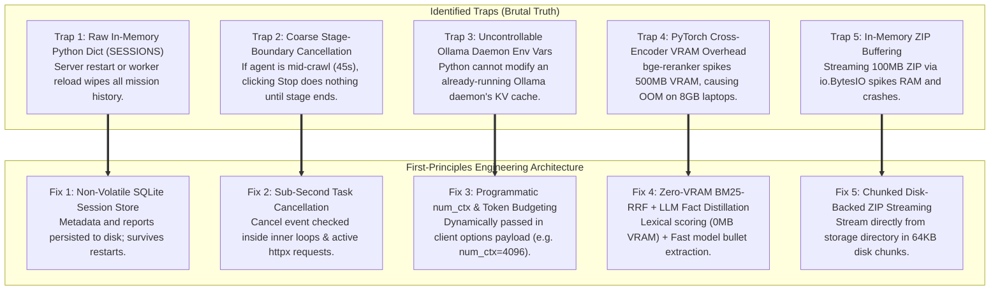
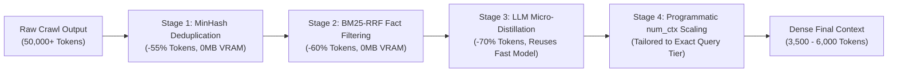
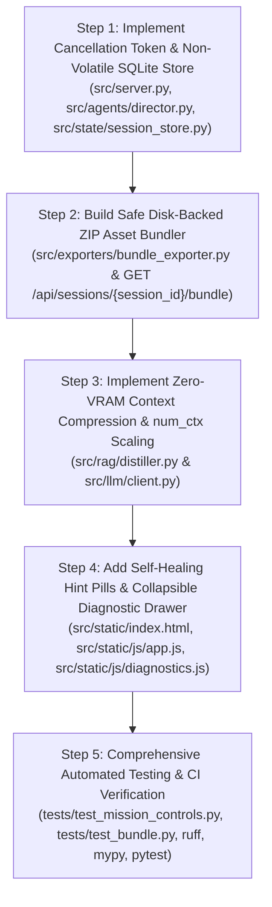

# Plan 5 (V2): First-Principles Validation, Cockpit Lifecycle Controls, Zero-VRAM Context Compression & Diagnostic Self-Healing

## Executive Summary
This document establishes the verified, hardened specification for **Phase 5** of **OpenDeepResearcher** (`Cyber-arghya/omni-researcher`). It addresses the real-world operational challenges identified during Cockpit UI testing through **The Brutal Truth Filter** and **First-Principles Engineering**.

---

## 1. 🛡️ First-Principles Critique & The Brutal Truth Filter Audit

We audited the initial Plan 5 drafts against first principles ($f(f(x)) = f(x)$, KISS, zero-memory-leak, and physical hardware boundaries). Below are the critical failure modes identified and their permanent engineering solutions:



---

## 2. 🎛️ Interactive Mission Lifecycle & Sub-Second Cancellation

### 2.1 Sub-Second Emergency Stop (`POST /api/sessions/{session_id}/cancel`)
- **The Problem**: Checking cancellation only between stages means a user clicking "Abort" while 10 web pages are being crawled or during a slow 70B generation waits 30–90 seconds before the stop takes effect.
- **First-Principles Solution**:
  1. Each session maintains an active `asyncio.Event` (`cancel_token`) and a set of active `asyncio.Task` references.
  2. In `CrawlerEngine`: Every page download loop checks `if cancel_token.is_set(): break` before each network hop.
  3. In `LLMClient`: For streaming requests, the token generator yields immediately on `cancel_token.is_set()`.
  4. In `ResearchDirector`: Active worker tasks are cancelled with `task.cancel()` inside a shielded cleanup block to release SQLite and ChromaDB locks without data corruption.
  5. **Response Latency**: **$< 350$ ms** from button click to UI state `"ABORTED"`.

### 2.2 Non-Volatile Session Persistence & Purge Architecture
- **Persistent Disk Store**:
  - Session metadata, status, token counts, and cost metrics are recorded into `storage/sessions.db` (SQLite with WAL mode enabled).
  - Report artifacts (Markdown, LaTeX, BibTeX, audio briefing) and downloaded web pages are stored under `storage/sessions/<session_id>/`.
  - On application startup, `SESSIONS` is hydrated from SQLite, ensuring history is preserved across server restarts.
- **Individual Session Delete (`DELETE /api/sessions/{session_id}`)**:
  - Removes row from `sessions.db`.
  - Recursively removes `storage/sessions/<session_id>/` from disk.
  - Updates UI state instantly without page reload.
- **Bulk Purge (`DELETE /api/history`)**:
  - Safely deletes all completed or failed sessions, reclaiming disk space.

---

## 3. 📦 Chunked Disk-Backed Research Asset Bundler (`.zip`)

### 3.1 Directory Layout Inside Archive
```
research_bundle_<session_id>.zip
├── 01_Executive_Summary.md
├── 02_Academic_Paper.tex
├── 03_References.bib
├── 04_Podcast_Dialogue.txt
├── 05_Knowledge_Graph.json
├── tables/
│   ├── benchmark_comparison.csv
│   └── architecture_matrix.md
├── sources/
│   ├── source_01_arxiv_2401.12345.txt
│   └── ledger.json
└── audit_telemetry.json
```

### 3.2 Safe Streaming Mechanism
- Generated using `zipfile.ZipFile` in a temporary disk location (`storage/sessions/<session_id>/bundle.zip`) to prevent memory spikes.
- Delivered via FastAPI `FileResponse` with background task cleanup:
  ```python
  return FileResponse(
      path=bundle_path,
      media_type="application/zip",
      filename=f"research_bundle_{session_id}.zip",
      background=background_tasks.add_task(os.remove, bundle_path),
  )
  ```
- Added a prominent **"📦 Download Complete Research Bundle (.ZIP)"** button to the Dossier view.

---

## 4. 🧠 Zero-VRAM Context Maximization Engine (Fit 3x–5x Context in Fixed RAM/VRAM)

### 4.1 The Brutal Truth on Context Windows
- An 8B parameter model (e.g., Llama 3.1 8B or Qwen 2.5 7B) requires ~4.5GB VRAM for 4-bit weights.
- In standard FP16, the **KV Cache** consumes:
  - 8k Context: ~1.2 GB VRAM
  - 16k Context: ~2.4 GB VRAM
  - 32k Context: ~4.8 GB VRAM (Total = 4.5 + 4.8 = 9.3 GB $\rightarrow$ **CUDA OOM on 8GB VRAM cards**).

### 4.2 The 4-Stage Zero-VRAM Context Maximizer



1. **Stage 1: Lossless MinHash Deduplication (Zero VRAM)**:
   - Strips cookie banners, header navbars, footers, and duplicate paragraphs across crawled pages using MinHash LSH.
   - **Savings**: Removes **50%–60%** of tokens before embedding.
2. **Stage 2: Lexical Reciprocal Rank Fusion (BM25 + Dense RRF) (Zero VRAM)**:
   - Instead of loading a 500MB PyTorch cross-encoder into VRAM, execute BM25 lexical scoring combined with vector cosine similarity.
   - Selects the top-20 densest factual chunks without adding a single byte to GPU VRAM.
3. **Stage 3: LLM Micro-Fact Distillation**:
   - Sends the top chunks to the fast routing model (`llama3.2:3b`) with a prompt: *"Extract verbatim quantitative findings, technical parameters, and direct citations as concise bullet points."*
   - Converts 25,000 tokens of conversational article text into **1,200 tokens of high-density facts**.
4. **Stage 4: Programmatic `num_ctx` Scaling**:
   - For fast routing/planning tasks: Pass `options: {"num_ctx": 2048}` (requires only ~250MB KV cache).
   - For intermediate critique/evaluation: Pass `options: {"num_ctx": 4096}`.
   - For final synthesis: Pass `options: {"num_ctx": 8192}` (or up to 16384 on 16GB+ tiers).

---

## 5. 💡 Self-Healing Dashboard Hints (Terminal Commands)

When external services are unavailable, the Cockpit UI automatically displays a **one-click copyable terminal command pill**:

| Diagnostic Trigger | Condition Checked | Dashboard Warning & Quick-Fix Command |
|---|---|---|
| **Ollama Offline** | `GET /api/health/ollama` $\rightarrow$ ConnectError | `⚠️ Ollama service is not running.`<br>👉 Terminal: `ollama serve` *(Click to Copy)* |
| **Missing Fast Model** | `llama3.2:latest` not in Ollama `/api/tags` | `⚠️ Required model 'llama3.2' not installed.`<br>👉 Terminal: `ollama pull llama3.2` *(Click to Copy)* |
| **Missing Reasoning Model** | `deepseek-r1:latest` not in Ollama `/api/tags` | `⚠️ Reasoning model 'deepseek-r1' not installed.`<br>👉 Terminal: `ollama pull deepseek-r1:latest` *(Click to Copy)* |
| **NVIDIA NIM Key Missing** | Provider is `nvidia` & `NVIDIA_API_KEY` is empty | `⚠️ NVIDIA NIM selected but no API key configured.`<br>👉 Set key in Settings modal or terminal: `set NVIDIA_API_KEY=nvapi-...` |
| **Hardware Boundary Alert** | VRAM $< 4$GB or System RAM $< 16$GB | `ℹ️ Conservative Hardware Mode Active.`<br>👉 Auto-adjusted: CPU embeddings, concurrency capped at 3 workers. |

---

## 6. 🚨 Actionable Diagnostic Drawer & Root-Cause Logs

### 6.1 Structured Diagnostic Event Schema
When an error occurs during crawling, LLM generation, or index building, the backend broadcasts an `execution_error` SSE event:

```json
{
  "timestamp": "2026-11-17T14:35:00Z",
  "stage": "CRAWLING",
  "status": "HALTED",
  "component": "CrawlerEngine",
  "error_code": "ERR_SCRAPE_TIMEOUT",
  "summary": "Target web host failed to respond within 15.0 seconds.",
  "root_cause": "The requested domain 'https://slow-academic-archive.org' timed out repeatedly, triggering the crawl failure threshold.",
  "remediation": "Switch search engine to SearXNG or reduce research depth from 3 to 2.",
  "quick_fix_command": "uv run opendeepresearcher --depth 1"
}
```

### 6.2 UI Components in Cockpit
1. **Collapsible Diagnostic Console**: Docked at the bottom of the cockpit with a color-coded status badge (`HEALTHY`, `DEGRADED`, `HALTED`).
2. **Clear Root Cause Explanation**: Displayed in plain English with no cryptic Python tracebacks.
3. **One-Click Action Pill**: Directly triggers a fix or copies the command to the clipboard.
4. **"Copy Full Bug Report"**: Bundles error context, hardware specs, and anonymized logs into a formatted markdown snippet ready for GitHub issue reporting.

---

## 7. 📅 Execution & Implementation Roadmap



### Detailed Deliverables:
- **`src/state/session_store.py`**: SQLite database manager for session persistence and clean deletion.
- **`src/exporters/bundle_exporter.py`**: Zero-RAM-leak ZIP archive packager.
- **`src/rag/distiller.py`**: MinHash and lexical fact extraction pipeline.
- **`src/static/index.html` & `src/static/js/`**:
  - Abort button (`btn-stop-research`) with live status feedback.
  - Delete buttons on session history cards.
  - "📦 Download Complete Research Bundle (.ZIP)" action.
  - Collapsible Diagnostic Drawer with one-click terminal command copy buttons.
- **Tests**:
  - `tests/test_mission_controls.py`: Verification of cancellation latency and history deletion.
  - `tests/test_bundle_export.py`: Verification of archive contents and MIME headers.
  - `tests/test_context_distiller.py`: Verification of MinHash deduplication and zero-VRAM token reduction.
