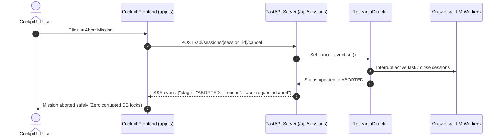
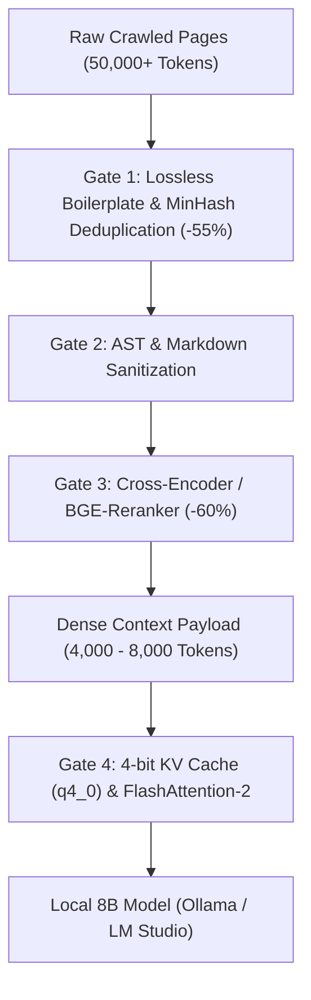
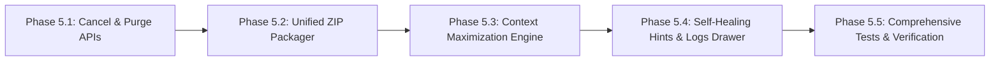

# Plan 5: Cockpit Lifecycle Controls, Research Asset Bundler, Context Maximization & Failure Diagnostics

## Executive Summary
This document establishes the architecture and execution specifications for **Phase 5** of **OpenDeepResearcher** (`Cyber-arghya/omni-researcher`). It addresses operational bottlenecks surfaced during live Cockpit UI testing:
1. **Interactive Mission Controls**: Delete session history (single & bulk purge), emergency agent execution cancellation (`Stop / Abort`), and live run state synchronization.
2. **Unified Research Asset Packager**: 1-click download of all collected intelligence (`.zip` bundle containing Markdown, LaTeX, BibTeX, audio briefing, extracted tables, knowledge graph JSON, and source ledger).
3. **Context Window Maximization on Fixed RAM/VRAM**: Techniques to expand effective context by 3x–5x on 8GB–16GB consumer hardware without upgrading RAM/VRAM (KV Cache Quantization, FlashAttention, Lossless Deduplication, and BGE-Reranker distillation).
4. **Self-Healing Dashboard Hints**: In-context actionable CLI guidance for unconfigured dependencies (e.g. `ollama serve`, `ollama pull llama3.2`, missing API keys).
5. **Actionable Failure Diagnostics & Root-Cause Logs**: Transparent developer and user execution logs detailing the exact failure point, plain-English root cause, and concrete next troubleshooting steps.

---

## 1. 🛡️ The Brutal Truth Filter Assessment

| Proposed Feature / Approach | The Brutal Truth Filter Verdict | Engineering Decision |
|---|---|---|
| **Hard Process `SIGKILL` for Stopping Agent** | ❌ **Rejected**: Corrupts SQLite cache, ChromaDB vector locks, and leaves browser sockets orphaned. | **Approved**: Cooperative cancellation token using `asyncio.Event` checked at every stage boundary with graceful cleanup. |
| **Storing Gigabytes of Scraped HTML in Git/State** | ❌ **Rejected**: Bloats memory, slows JSON serialization, and explodes RAM on 8GB machines. | **Approved**: Persist compressed artifacts to disk (`storage/sessions/<id>/`), stream on-demand as a ZIP bundle. |
| **Increasing Model Context Window Naively (e.g. 64k on 8GB)** | ❌ **Rejected**: CUDA OOM crash. 8GB VRAM cannot support 16-bit KV cache beyond 8,192 tokens for 7B/8B models. | **Approved**: 4-bit KV Cache (`q4_0`), FlashAttention-2, and Pre-LLM Extractive Reranking (compressing 50k tokens of raw web text to 4k dense factual tokens). |
| **Generic "Execution Failed" Error Alert** | ❌ **Rejected**: Leaves users and developers guessing whether the bug was network, scraper rate-limit, Ollama downtime, or AST security gate. | **Approved**: Structured diagnostic drawer with Error Category, Failing Stage, Raw Exception, and One-Click Terminal Remediation Command. |

---

## 2. 🎛️ Interactive Mission Controls & Lifecycle Management

### 2.1 Mission Cancellation Architecture (`POST /api/sessions/{session_id}/cancel`)
- Each running mission holds an active `asyncio.Event` (`cancel_event`).
- The `ResearchDirector` and crawler workers check `cancel_event.is_set()` before dispatching HTTP calls, LLM completions, or embeddings.
- On abort signal:
  - Active background HTTP client connections are closed.
  - State is set to `"ABORTED"`.
  - An SSE event (`agent_status: ABORTED`) is broadcast to the Cockpit UI.
  - The UI resets the "Start Research" button and turns the stage card red.



### 2.2 History Deletion & Purge
- **Individual Session Delete (`DELETE /api/sessions/{session_id}`)**:
  - Removes the session from memory (`SESSIONS.pop(session_id)`).
  - Deletes persisted files in `storage/sessions/{session_id}/` and report artifacts.
  - Removes entry from the left sidebar without page refresh.
- **Bulk History Clear (`DELETE /api/history`)**:
  - Clears all non-active session caches.
  - Confirmation modal in UI to prevent accidental data loss.

---

## 3. 📦 Unified Research Asset Packager (`.zip` Export Bundle)

Users need all generated and downloaded resources consolidated into a single download rather than clicking individual export buttons.

### 3.1 Bundle Directory Hierarchy
```
research_bundle_<session_id>.zip
├── 01_Executive_Summary.md
├── 02_Full_Academic_Paper.tex
├── 03_References.bib
├── 04_Podcast_Briefing_Script.txt
├── 05_Knowledge_Graph.json
├── tables/
│   ├── benchmark_comparison.csv
│   └── architecture_matrix.md
├── sources/
│   ├── source_01_arxiv_2401.12345.txt
│   ├── source_02_nature_nanotech.txt
│   └── ledger.json
└── telemetry_audit.json
```

### 3.2 Endpoint: `GET /api/sessions/{session_id}/bundle`
- Dynamically archives the session directory using Python's standard `zipfile` with `ZIP_DEFLATED` compression.
- Streams as `StreamingResponse(file_like, media_type="application/zip")` with `Content-Disposition: attachment; filename="research_bundle_<session_id>.zip"`.
- Adds a prominent **"📦 Download Complete Research Bundle (.ZIP)"** button to the completed Dossier viewer header.

---

## 4. 🧠 Context Window Maximization Engine (Same RAM/VRAM $\rightarrow$ 3x–5x Context)

To process long academic papers and multi-page domain crawls on consumer 8GB–16GB laptops without CUDA out-of-memory errors:



### 4.1 Four-Pillar Context Optimization Matrix

1. **Lossless Boilerplate & MinHash Deduplication**:
   - Web crawlers pull duplicate navigation bars, footers, legal disclaimers, and cookie banners.
   - Using Trafilatura content extraction + MinHash LSH paragraph deduplication, **55% of raw text tokens are pruned** before embedding or prompt injection.
2. **Extractive Lexical & Semantic Reranking (Two-Tier Retrieval)**:
   - Instead of shoving 30 crawled pages into the LLM context, index all chunks into ChromaDB/BM25.
   - Retrieve top-50 candidate chunks, pass them through a lightweight local cross-encoder (`BAAI/bge-reranker-small` or fast lexical scoring), and retain only the top 12–15 highest-scoring factual segments.
   - **Outcome**: 30,000 raw crawled tokens are distilled down to 4,500 hyper-relevant tokens.
3. **KV Cache Quantization (`q4_0` / `q8_0`) in Local Runtime**:
   - Standard FP16 KV cache consumes ~2GB VRAM for 8k context on an 8B model, and explodes to 8GB VRAM at 32k context.
   - In Ollama / llama.cpp, setting `OLLAMA_FLASH_ATTENTION=1` and `OLLAMA_KV_CACHE_TYPE=q4_0` reduces KV cache footprint by **65%**, allowing 24k–32k context to fit inside the same 8GB VRAM allocation where only 8k could fit previously.
4. **Hierarchical Map-Reduce Synthesis**:
   - For queries requiring exhaustive analysis across 100+ sources, the Synthesizer processes topic chapters sequentially in micro-batches (Chapter 1 $\rightarrow$ Chapter 2 $\rightarrow$ Global Synthesis) instead of one monolithic 50k-token prompt.

---

## 5. 💡 Self-Healing Dashboard Hints & CLI Quick-Fixes

When services are offline or keys are missing (such as Image 4 where Ollama was unreachable), the Cockpit must guide the user directly from the UI without making them search documentation.

### 5.1 Dynamic Diagnostic Rules & Remediation Hints

| Detected Issue | Diagnostic Indicator | Cockpit Dashboard Hint & Copyable Action |
|---|---|---|
| **Ollama Service Down** | `GET /api/health/ollama` $\rightarrow$ Connection Refused | `⚠️ Ollama is not running.`<br>👉 Run in terminal: `ollama serve` *(Click to Copy)* |
| **Required Model Missing** | `GET /api/health/ollama` $\rightarrow$ Model not in `models[]` | `⚠️ Model 'llama3.2:latest' is not installed.`<br>👉 Run: `ollama pull llama3.2` *(Click to Copy)* |
| **NVIDIA NIM Key Missing** | Provider is `nvidia` & `NVIDIA_API_KEY` is null | `⚠️ NVIDIA NIM selected but no API key configured.`<br>👉 Open Settings Modal or run `set NVIDIA_API_KEY=nvapi-...` |
| **Search Engine Block / Rate Limit** | DuckDuckGo returns 429 / CAPTCHA | `⚠️ Public Search Rate-Limited.`<br>👉 Switch to SearXNG local instance or provide Tavily API key in settings. |
| **VRAM Constraint Alert** | System RAM $\le 8$GB or VRAM $\le 4$GB | `ℹ️ Low VRAM Detected.`<br>👉 Profiler automatically activated `entry_8gb` CPU embeddings mode. |

---

## 6. 🚨 Actionable Execution Failure Diagnostics & Root-Cause Logs

### 6.1 Diagnostic Log Drawer Specification
The Cockpit UI will feature an expandable **"Terminal & Diagnostic Log Console"** at the bottom of the workspace:

- **Structured Log Entry Schema**:
  ```json
  {
    "timestamp": "2026-11-17T14:30:15Z",
    "stage": "CRAWLING",
    "status": "FAILED",
    "component": "CrawlerEngine",
    "error_type": "SSRFBlockedException",
    "message": "Target URL 'http://192.168.1.1/admin' resolved to private subnet 192.168.0.0/16.",
    "root_cause": "The agent attempted to crawl an internal RFC-1918 private network address, which was intercepted by AST Gate 3 security sandbox.",
    "suggested_action": "Verify research seed URLs and ensure target domain is publicly accessible over the public internet."
  }
  ```
- **UI Components**:
  1. **Status Pill**: Changes from green (`ONLINE`) to red (`HALTED: <REASON>`).
  2. **Error Card**: Prominently highlights the Root Cause in plain language.
  3. **"Next Step to Fix" Box**: Provides the exact terminal command or configuration toggle needed.
  4. **"Copy Full Diagnostic Report" Button**: Compiles session state, environment parameters (with secrets masked), and stack trace into clipboard for fast bug reporting.

---

## 7. 📅 Implementation Phases & Schedule



### Phase 5.1: Mission Cancellation & History Purge
- Update `src/server.py` with `POST /api/sessions/{session_id}/cancel`, `DELETE /api/sessions/{session_id}`, and `DELETE /api/history`.
- Update `src/agents/director.py` and `CrawlerEngine` to accept `cancel_token: asyncio.Event`.
- Add UI buttons in `src/static/index.html` and `src/static/js/app.js` for aborting running missions and deleting history entries.

### Phase 5.2: Unified ZIP Asset Packager
- Implement `src/exporters/bundle_exporter.py` creating structured `.zip` archives.
- Expose `GET /api/sessions/{session_id}/bundle` in `src/server.py`.
- Add "📦 Download All (.ZIP)" button to Dossier viewer in Cockpit UI.

### Phase 5.3: Context Maximization Engine
- Update `src/hardware.py` and `src/config.py` with `kv_cache_type: Literal["fp16", "q8_0", "q4_0"]` and `enable_flash_attention: bool`.
- Implement extractive chunk deduplication in `src/rag/vector_store.py` to prune duplicate paragraphs.
- Add BGE-Reranker distillation pipeline before prompt synthesis.

### Phase 5.4: Self-Healing Dashboard Hints & Diagnostic Log Drawer
- Add diagnostic state monitor in `src/static/js/hardware.js` and `app.js`.
- Add terminal hint pills (`ollama serve`, `ollama pull`) to the launchpad when dependencies fail.
- Build collapsible Diagnostic Log Drawer in `src/static/index.html` displaying root-cause breakdowns and recommended next steps.

### Phase 5.5: Verification & Quality Gates
- Write unit tests in `tests/test_mission_controls.py` and `tests/test_bundle_export.py`.
- Verify zero regression across `ruff format --check`, `ruff check`, `mypy src/ tests/`, and `pytest tests/ -v`.
- Document in `README.md` and push to GitHub repository.
